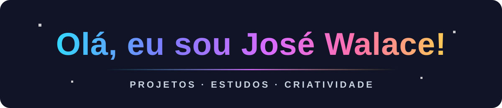

<h1 align="center">
  
</h1>

Cada repositório é uma nova fase da minha jornada. Explore meus estudos e projetos!

  
  &nbsp;
  
  &nbsp;
  

---

<h2></h2>

   
   
   
   
  

<h2></h2>

  
  &nbsp;&nbsp;
  
  &nbsp;&nbsp;
  

<h2></h2>

 

  

---

