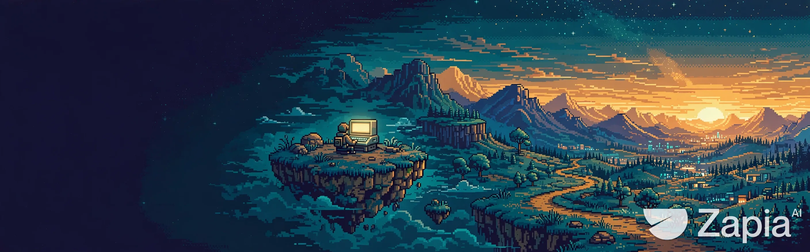

# 👋 Olá, eu sou José Walace!

### Aprendendo tecnologia e colocando ideias em prática.

Cada repositório é uma nova fase da minha jornada — explore meus estudos e projetos.

  <a href="https://github.com/Horaquytsume?tab=repositories">🎮 Explorar projetos</a>
  &nbsp;·&nbsp;
  <a href="#tecnologias">🧰 Ver tecnologias</a>
  &nbsp;·&nbsp;
  <a href="#estatisticas">📊 Abrir estatísticas</a>

---

## 🗺️ Fases em andamento

- [Curso HTML e CSS — SENAC](https://github.com/Horaquytsume/Curso_Html_Css_senac)
- [Curso HTML e CSS](https://github.com/Horaquytsume/Curso_Html.Css)
- [CSS e HTML](https://github.com/Horaquytsume/CSS_HTML_CSS)
- [Cafeteria](https://github.com/Horaquytsume/cafeteria)

## 🧰 Tecnologias

  
  &nbsp;&nbsp;
  

## 📊 Estatísticas

✨ Clique para revelar minhas estatísticas públicas

 

  

---

💜 Obrigado por visitar meu perfil! Que comece a próxima fase.

